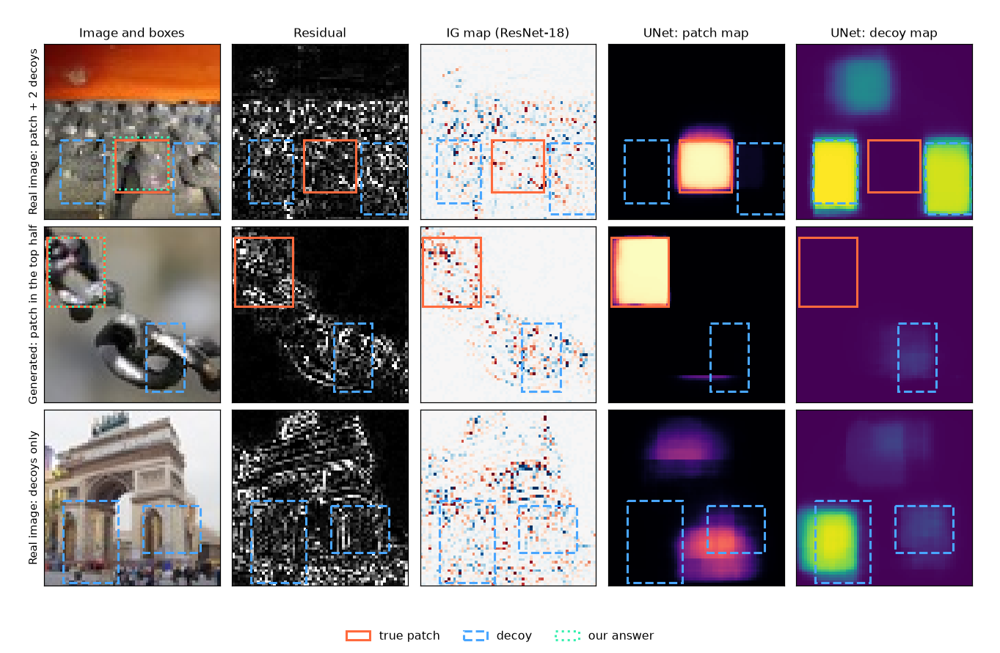

# AI/ML Security

AI models now make decisions in many systems: cameras, spam filters, medical tools and cars. These models have weak points. A small change to the input, too small for a human to see, can make a model give a wrong answer. An attacker can also poison the data that a model learns from, or copy a model.

This repository has our projects about these problems. In each project, we examine one security problem of AI models in practice.

## Table of Contents

- [Project 1 - Hidden Adversarial Patch](#project-1---hidden-adversarial-patch)
- Project 2 - TBD
- Project 3 - TBD
- Project 4 - TBD
- Project 5 - TBD
- Project 6 - TBD

---

## Project 1 - Hidden Adversarial Patch

> Full report: [`pro1-hidden-patch/README.md`](pro1-hidden-patch/README.md)

An image of 64 × 64 pixels can hide a rectangle of weak adversarial noise. This patch makes ResNet-18 give a wrong class. Decoys have random noise of the same strength, but they do not change the class. The task is to find the box of the patch, or to answer `0,0,0,0` if the image has no patch.

*Orange: the true patch. Blue: decoys. Green: our answer. The noise is in all rectangles, but our UNet marks only the patch.*

### Solution

1. **More data.** All train patches are in the bottom half, but approximately half of the test patches are in the top half. We attacked ResNet-18 ourselves and made 92,166 new images with patches at all positions.
2. **Hints from ResNet-18.** Gradient and activation maps show where the noise pushes the answer of ResNet-18.
3. **Two UNets.** From the image and the hints, two UNets draw a patch map and a decoy map.
4. **Final check.** For the best candidate boxes, we remove the noise only inside the box and ask ResNet-18 again. Only the true patch changes the class. If no box changes it, the answer is `0,0,0,0`.

### Results

The score is the mean IoU (a correct `0,0,0,0` gets 1 point).

| Method                         | Val   | Gen val |
|--------------------------------|:-----:|:-------:|
| Always `0,0,0,0`               | 0.200 | 0.000   |
| unet-v9a only                  | 0.686 | 0.588   |
| unet-v12 only                  | 0.695 | 0.598   |
| **Final: unet-v9a + unet-v12** | **0.707** | **0.601** |
