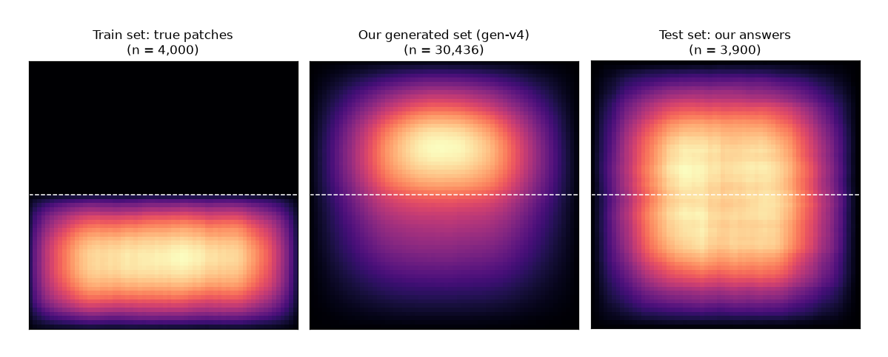
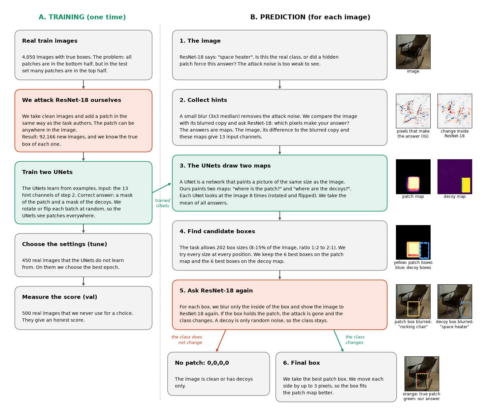
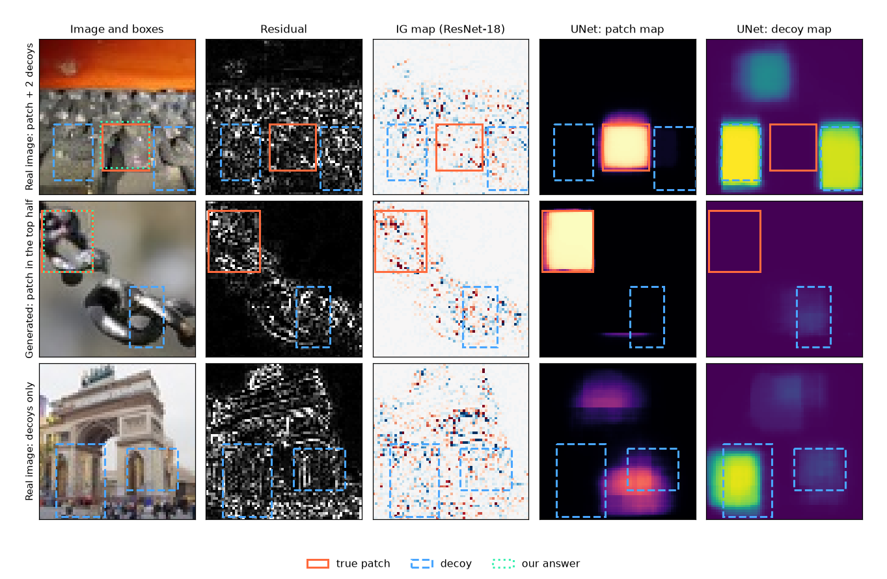

# Project 1 - Hidden Adversarial Patch

## Task

Each image has 64 × 64 pixels. Most images have weak adversarial noise in one rectangle, the patch. This noise makes the ResNet-18 model give a wrong class. Many images also have decoys: rectangles with random noise of the same strength. A decoy does not change the class. Of the images, 80% have a patch, 10% have decoys only and 10% are clean.

For each test image, the answer is the box of the patch, or `0,0,0,0` if the image has no patch. A correct `0,0,0,0` gets 1 point, a box gets its IoU with the true patch, and a box on a decoy gets 0 points.

## Data

The noise is too weak to see. A 3 × 3 median filter removes it, so the difference between the image and its filtered copy shows the noise. This difference also shows the edges in the image, and a decoy looks the same as a patch. The one difference between a patch and a decoy is the effect on ResNet-18: only the patch changes its class.

In the train set, all patches are in the bottom half of the image. In the test set, approximately half of the patches are in the top half. A median filter on only the top half changes the class of ResNet-18 for 26% of the test images and for 5% of the train images. Also, approximately 20% of the test images have a JPEG quality of 80-88. All train images have a quality of 90-95.

*How often each pixel is inside a patch (bright = often). Left: the train set. Middle: our generated images. Right: our answers on the test set.*

## Method

The method uses ResNet-18 two times:

- **Hints.** Maps from ResNet-18 show where the noise pushes its answer. A UNet uses these maps and draws where the patch is.
- **Final check.** We remove the noise from a candidate box. If the class of ResNet-18 changes, the box is the patch.

### Training

The train set has only 4,000 patches, all in the bottom half. Thus we made more data with the same four attacks as the task (PGD, targeted PGD, MI-FGSM and C&W). We took the clean and decoy-only train images, attacked ResNet-18 in a rectangle at a random position and saved the image with a JPEG quality of 80-95. The result is 92,166 new images with known boxes. During training, each batch gets a random rotation or flip, so the UNets see patches in all parts of the image.

The two UNets have the same structure. They differ only in the data and the training time:

| UNet     | Real images | Generated images | Epochs |
|----------|:-----------:|:----------------:|:------:|
| unet-v9a | 4,050       | 30,436           | 200    |
| unet-v12 | 4,050       | 92,166           | 100    |

### Prediction

1. We compare the image with its filtered copy and ask ResNet-18 which pixels make its answer. The UNet gets 13 input channels:
   - the image (3 channels: red, green, blue),
   - the difference between the image and its filtered copy (3 channels). It shows all fine noise: the patch, the decoys and the edges.
   - the integrated gradients map (1 channel). It shows which pixels give ResNet-18 its confidence.
   - 6 activation maps. For three layers inside ResNet-18 (layer 1, 2 and 3), one map shows how much the noise changes the layer, and one map shows if this change pushes the answer of ResNet-18.
2. Both UNets draw a patch map and a decoy map. Each UNet looks at the image 8 times (rotated and flipped). The result is the mean of all answers.
3. The task allows 202 box sizes: all widths and heights in pixels with an area of 8-15% of the image and any ratio between 1:2 and 2:1 (for example 13 × 26, 20 × 20 or 34 × 18). We try every size at every position on the maps and keep the 6 best boxes on each map.
4. For each of these 12 boxes, we filter only the inside of the box and ask ResNet-18 again. If no box changes its answer enough, the answer is `0,0,0,0`.
5. Else we take the box with the highest mean value on the patch map. We move each side by up to 3 pixels, so that the box fits the patch map better.

*Top: a real image with a patch and two decoys. The noise is in all three rectangles, but the UNet marks only the patch. Middle: a generated image with the patch in the top half. Bottom: an image with decoys only. The patch map is not empty, but no box changes the answer of ResNet-18, so the answer is `0,0,0,0`.*

## Evaluation

The 5000 train images have three fixed parts:

| Part  | Images | Use |
|-------|:------:|-----|
| train | 4,050  | The UNets learn on these images. The generated images use only these images as bases. |
| tune  | 450    | We choose the settings here: the best epoch and the threshold of step 4. |
| val   | 500    | Only for the score. No choice uses these images. |

The val images have patches only in the bottom half. Thus we also use a generated val set (gen val): 1,100 images from val bases, each with a patch at a random position and a JPEG quality of 80-95.

## Results

| Method                         | Tune  | Val   | Gen val |
|--------------------------------|:-----:|:-----:|:-------:|
| Always `0,0,0,0`               | 0.178 | 0.200 | 0.000   |
| unet-v9a only                  | 0.695 | 0.686 | 0.588   |
| unet-v12 only                  | 0.701 | 0.695 | 0.598   |
| **Final: unet-v9a + unet-v12** | 0.700 | **0.707** | **0.601** |

The mean of the two UNets is better than each UNet on val and on gen val, because the two UNets make different mistakes. The score on gen val is lower than on val, because the patches in the top half and the low JPEG quality make these images more difficult.
