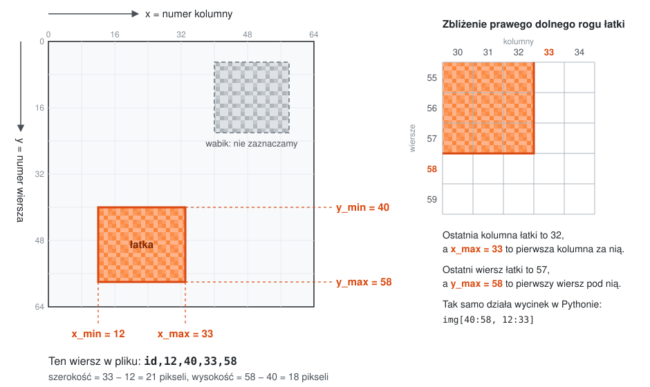
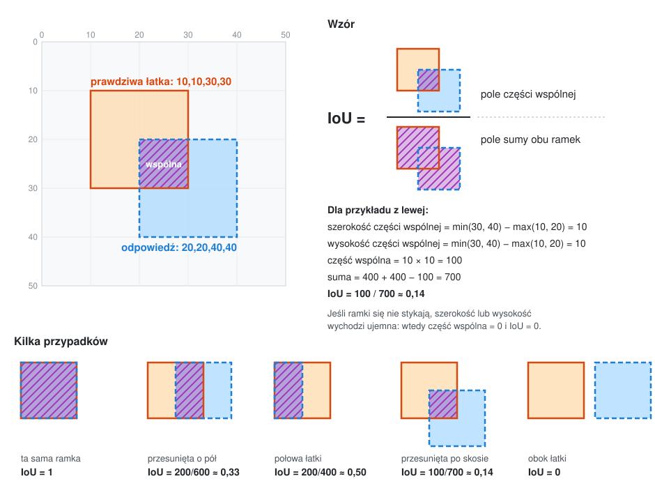

# P1: Ukryta łatka

Znajdź na obrazku prostokąt z atakiem na ResNet-18. Prostokąty z losowym szumem to wabiki i się nie liczą.

- Metryka: wynik (im wyższy, tym lepiej)
- Pliki .csv · ≤ 2.0 MB
- Limit 20 zgłoszeń na dobę na zespół
- Termin 2026-11-09 16:00

## Opis zadania

**TL;DR:** Dla danych obrazków znajdź ich fragment zaatakowany adwersaryjnie. Dla każdego obrazka testowego wyślij ramkę tego fragmentu (x_min,y_min,x_max,y_max) albo 0,0,0,0, jeśli na obrazku nie ma fragmentu adwersaryjnego.

## Zadanie

Obrazki mają 64 × 64 piksele. Atakowany był model ResNet-18, który dostajesz w `model/`. Na części obrazków do jednego prostokąta (łatki) dodano szum adwersaryjny, przez który ten model podaje złą klasę. Szum w łatce jest słaby i zwykle niewidoczny.

Na niektórych obrazkach są też wabiki: prostokąty z losowym szumem tej samej siły, które nie zmieniają odpowiedzi modelu. Odpowiedź wskazująca wabik zamiast łatki dostaje 0 punktów.

W treningu i w teście 80% obrazków ma łatkę (czasem obok wabików), 10% ma tylko wabiki, a 10% jest czystych. Część obrazków testowych jest trudniejsza niż treningowe.

## Dane

Link: p1_student.zip na Google Drive (131 MB).

- `model/`: ResNet-18 (`resnet.py`, wagi `resnet18_tin.pt`, 200 klas Tiny ImageNet w `classes.txt`). Wejście (N, 3, 64, 64) z wartościami w [0, 1].
- `train/images/` i `train_labels.csv`: 5000 obrazków z prawdziwymi ramkami i opisem (atak, ε, wabiki, jakość JPEG).
- `test/images/` i `test_ids.csv`: 5000 obrazków do oceny i lista ich id.
- `sample_submission.csv`: zgłoszenie w poprawnym formacie, z 0,0,0,0 dla każdego obrazka.

## Ramka

Ramka to cztery liczby całkowite x_min,y_min,x_max,y_max. Liczymy od lewego górnego rogu, x to kolumna, y to wiersz. x_max i y_max to pierwszy piksel za łatką, tak jak w `img[y_min:y_max, x_min:x_max]`.



## Zgłoszenie

Plik CSV z jednym wierszem na każdy z 5000 obrazków testowych, w dowolnej kolejności:

```
id,x_min,y_min,x_max,y_max
3fa9c01b77de,12,40,33,58
9b04e6a1c2f0,0,0,0,0
```

Portal odrzuci plik, jeśli brakuje któregoś id, któreś się powtarza albo nie należy do testu, współrzędna nie jest liczbą całkowitą od 0 do 64 albo x_min > x_max lub y_min > y_max. Odrzucony plik też liczy się do dziennego limitu.

## Ocena

| Na obrazku   | Odpowiedź | Punkty |
|--------------|-----------|:------:|
| nie ma łatki | 0,0,0,0   | 1      |
| nie ma łatki | ramka     | 0      |
| jest łatka   | 0,0,0,0   | 0      |
| jest łatka   | ramka     | IoU    |

IoU = część wspólna / (pole A + pole B − część wspólna)



Serwer liczy punkty tą funkcją (ramka to (x_min, y_min, x_max, y_max)):

```python
NONE = (0, 0, 0, 0)

def punkty(prawda, odpowiedz):
    if prawda == NONE:
        return 1.0 if odpowiedz == NONE else 0.0
    if odpowiedz == NONE:
        return 0.0
    w = max(0, min(prawda[2], odpowiedz[2]) - max(prawda[0], odpowiedz[0]))
    h = max(0, min(prawda[3], odpowiedz[3]) - max(prawda[1], odpowiedz[1]))
    wspolna = w * h
    pole = lambda b: (b[2] - b[0]) * (b[3] - b[1])
    return wspolna / (pole(prawda) + pole(odpowiedz) - wspolna)
```

Wynik to średnia punktów po obrazkach. Odpowiedź 0,0,0,0 dla każdego obrazka daje 0,2000, a baseline na tablicy wyników ma 0,2200. Pusta ramka, np. 5,5,5,5, zawsze dostaje 0.

## Ranking

Tablica wyników pokazuje wynik na losowej połowie testu (2500 obrazków). Ranking końcowy liczę po terminie na drugiej połowie. Biorę do niego zgłoszenie zespołu z najlepszym wynikiem na tablicy. Różnice poniżej około 0,02 mogą być przypadkiem.

Limit: 20 zgłoszeń na dobę na zespół. Termin: 9 listopada 2026, 16:00.

## Jak powstały dane

- Czyste obrazki są z modelu generatywnego, nie z publicznego zbioru.
- Ataki, każdy w około 25% łatek: PGD L∞ bez klasy docelowej (100 kroków), PGD L∞ z klasą docelową (100 kroków), MI-FGSM L∞ (20 kroków), Carlini–Wagner L2 (100 kroków). To własne implementacje z maską, która ogranicza szum do łatki. Standardowe wersje tych ataków są w torchattacks.
- Ataki liczyły gradient przez kompresję JPEG, więc łatka działa także po zapisie pliku.
- ε to najmniejsza wartość, przy której atak działa. W zbiorze treningowym jest od 2/255 do 20/255. W C&W szukana jest najmniejsza działająca norma L2, a żaden piksel nie zmienia się o więcej niż 20/255.
- Każdy obrazek przeszedł przez JPEG (w zbiorze treningowym jakość 90–95) i zapis do PNG. Łatka na pewno myli model na zapisanym pliku, wabik na pewno nie.
- Wabiki to szum ±ε, jednostajny albo gaussowski, o sile z tego samego rozkładu co łatki.
- Prostokąty zajmują 8–15% pola obrazka, mają proporcje od 1:2 do 2:1 i nie nachodzą na siebie.

## Sugerowana literatura

Poniższe prace nie są obowiązkowe. Pomagają zrozumieć ataki użyte w zadaniu i znaleźć pomysł na rozwiązanie.

### Ataki

- Goodfellow, Shlens, Szegedy, Explaining and Harnessing Adversarial Examples, ICLR 2015, arXiv:1412.6572. Atak FGSM, od którego wywodzą się PGD i MI-FGSM.
- Madry i in., Towards Deep Learning Models Resistant to Adversarial Attacks, ICLR 2018, arXiv:1706.06083. Atak PGD.
- Dong i in., Boosting Adversarial Attacks with Momentum, CVPR 2018, arXiv:1710.06081. Atak MI-FGSM.
- Carlini, Wagner, Towards Evaluating the Robustness of Neural Networks, IEEE S&P 2017, arXiv:1608.04644. Atak C&W.
- Brown i in., Adversarial Patch, 2017, arXiv:1712.09665, oraz Karmon, Zoran, Goldberg, LaVAN: Localized and Visible Adversarial Noise, ICML 2018, arXiv:1801.02608. Ataki ograniczone do fragmentu obrazka. U nich łatka jest widoczna, w tym zadaniu jest słaba.
- Dziugaite, Ghahramani, Roy, A study of the effect of JPG compression on adversarial images, 2016, arXiv:1608.00853. Co kompresja JPEG robi z perturbacją.
- Kim, Torchattacks: A PyTorch Repository for Adversarial Attacks, 2020, arXiv:2010.01950. Biblioteka ze standardowymi implementacjami tych czterech ataków.

### Wykrywanie ataków

- Metzen i in., On Detecting Adversarial Perturbations, ICLR 2017, arXiv:1702.04267. Mała sieć-detektor uczona na aktywacjach klasyfikatora.
- Xu, Evans, Qi, Feature Squeezing: Detecting Adversarial Examples in Deep Neural Networks, NDSS 2018, arXiv:1704.01155. Porównanie odpowiedzi modelu przed i po „ściśnięciu” obrazka (mniej bitów na kolor, wygładzanie). Działa bez uczenia.
- Ma i in., Characterizing Adversarial Subspaces Using Local Intrinsic Dimensionality, ICLR 2018, arXiv:1801.02613, oraz Lee i in., A Simple Unified Framework for Detecting Out-of-Distribution Samples and Adversarial Attacks, NeurIPS 2018, arXiv:1807.03888. Detektory oparte na statystykach aktywacji w warstwach sieci.
- Liu i in., Detection based Defense against Adversarial Examples from the Steganalysis Point of View, CVPR 2019, arXiv:1806.09186, oraz Fridrich, Kodovský, Rich Models for Steganalysis of Digital Images, IEEE TIFS 2012, doi:10.1109/TIFS.2012.2190402. Szukanie śladów perturbacji w szumie wysokoczęstotliwościowym obrazka, tak jak w steganalizie szuka się ukrytych wiadomości.
- Carlini, Wagner, Adversarial Examples Are Not Easily Detected: Bypassing Ten Detection Methods, AISec 2017, arXiv:1705.07263. Przegląd dziesięciu detektorów i ich słabych punktów.

### Lokalizowanie zaatakowanego obszaru

- Simonyan, Vedaldi, Zisserman, Deep Inside Convolutional Networks: Visualising Image Classification Models and Saliency Maps, 2014, arXiv:1312.6034. Mapa gradientu: które piksele najbardziej wpływają na decyzję.
- Selvaraju i in., Grad-CAM: Visual Explanations from Deep Networks via Gradient-based Localization, ICCV 2017, arXiv:1610.02391. Mapa ważności z ostatnich warstw konwolucyjnych.
- Zeiler, Fergus, Visualizing and Understanding Convolutional Networks, ECCV 2014, arXiv:1311.2901, oraz Petsiuk, Das, Saenko, RISE: Randomized Input Sampling for Explanation of Black-box Models, BMVC 2018, arXiv:1806.07421. Zasłanianie fragmentów obrazka i obserwowanie, jak zmienia się odpowiedź modelu.
- Chou, Tramèr, Pellegrino, SentiNet: Detecting Localized Universal Attacks Against Deep Learning Systems, IEEE S&P Workshops 2020, arXiv:1812.00292. Wskazywanie fragmentu obrazka odpowiedzialnego za atak za pomocą Grad-CAM.
- Naseer, Khan, Porikli, Local Gradients Smoothing: Defense against localized adversarial attacks, WACV 2019, arXiv:1807.01216. Wykrywanie lokalnej perturbacji po nietypowo dużych gradientach obrazu.
- Xiang i in., PatchGuard: A Provably Robust Defense against Adversarial Patches via Small Receptive Fields and Masking, USENIX Security 2021, arXiv:2005.10884. Maskowanie podejrzanego obszaru na podstawie lokalnych cech sieci.
