# Project 2 - Backdoor Detection

## Task

We get 200 ResNet-18 models for 20 classes of 64 × 64 images. Approximately half of them have 1-3 backdoors: an image with a trigger goes to the class that the attacker selected. For each model and each class, we give a number: a larger number means a larger suspicion that this class is a backdoor target.

All models have the same base model, the same data and the same finetune. Many test triggers are of a different type than in the train models. The score is the ROC-AUC of all 4,000 (model, class) pairs together, so the numbers of different models must be comparable.

## Data

- 400 clean images, 20 for each class.
- 6 train models with labels: 3 clean models and 3 models with one backdoor.
- 200 test models.

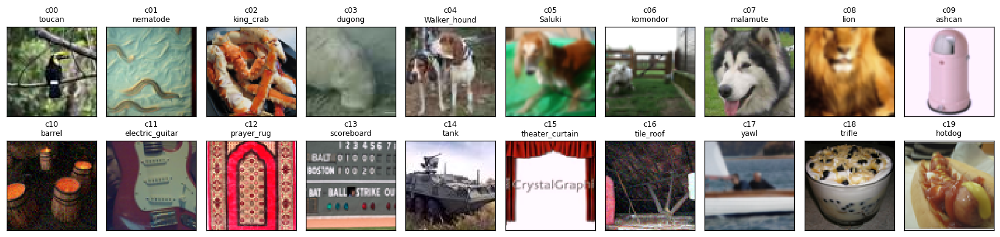

Six train models are too few to train a detector. A simple check of the accuracy also does not help: a model with a backdoor recognizes clean images as well as a clean model (0.84-0.85 for all 6 train models).

## Method

The detector trains no network. It uses two ideas:

1. **A backdoor is a wide shortcut.** The model learned the rule "pattern, so class X" from a few percent of the data. A similar pattern also activates this rule. Thus we do not need the exact trigger. We apply many different changes (probes) to clean images and look for a class that collects the images.
2. **The models are siblings.** All task models have the same base, data and finetune. A clean class reacts to a probe almost the same in all models. Thus we compare each class with the same class in all other models. A backdoor class is far from all of them.

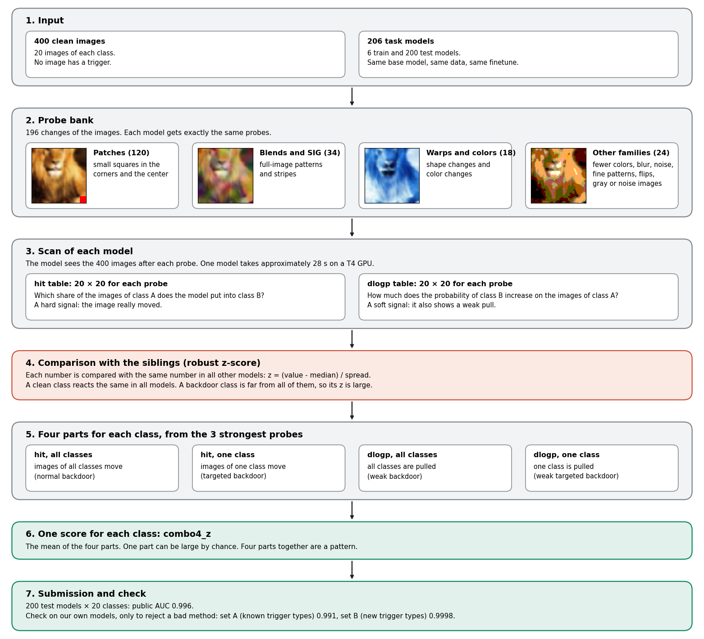

### The probe bank

A probe is a function that changes a batch of images. The bank has 196 probes in 9 families. All random patterns come from the seed 0, so each model gets exactly the same probes.

| Family | Probes | What it does | Similar attacks |
|---|:---:|---|---|
| Patches | 120 | A square of 4, 8 or 12 pixels in 5 positions, with 8 contents | BadNets |
| Blends | 18 | Mixes the image with a full-size pattern | Blended |
| SIG stripes | 16 | Adds horizontal or vertical sine stripes | SIG |
| Warps | 6 | Moves the pixels with a smooth field | WaNet |
| Color changes | 12 | Brightness, contrast, gray, invert, channel swap, tints | color filters |
| Lower quality | 9 | Fewer color levels, blur, down and up sampling, noise | BPP, noise |
| Frequency patterns | 5 | A fine checkerboard, smooth color noise | FTrojan, LF |
| Geometry | 5 | Flip, rotation, shift, zoom | transform triggers |
| Replacements | 5 | The full image becomes noise, gray, black or white | strong backdoors |

**Patches (120).** A square of 4, 8 or 12 pixels in a corner (`tl`, `tr`, `bl`, `br`) or in the `center`, with 6 colors, a checkerboard or noise. A patch is the most frequent trigger.

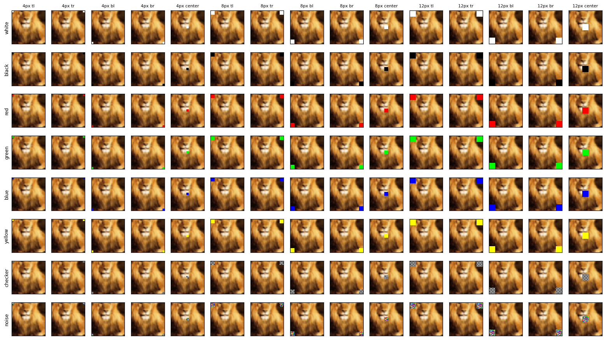

**Blends (18).** The image is mixed with a full-size pattern (noise, smooth color, checkerboard, diagonal stripes) at 10%, 20% or 30%.

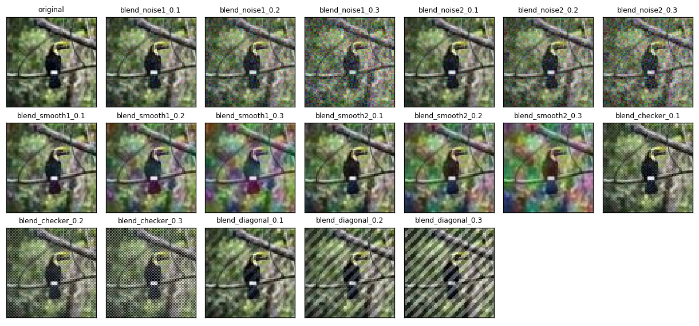

**SIG stripes (16).** Horizontal or vertical sine stripes with 4 frequencies and 2 strengths.

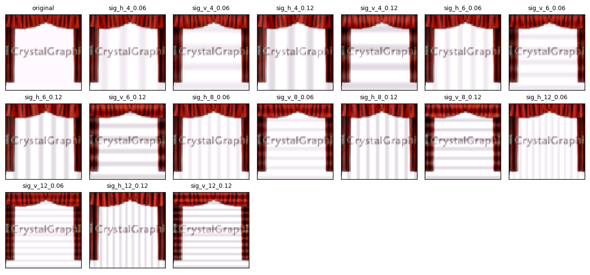

**Warps (6).** A smooth field moves the pixels by 1, 2 or 3 pixels. WaNet uses such an almost invisible warp.

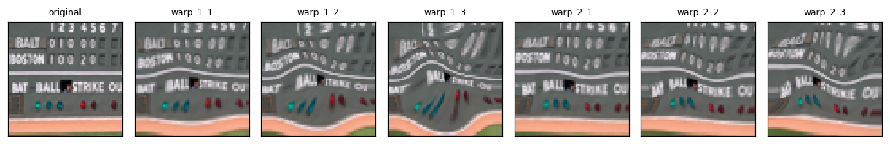

**Color changes (12).** Brighter, darker, more or less contrast, gray, inverted, channel swaps, more saturation and three color tints.

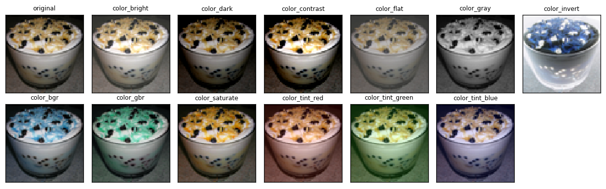

**Lower quality (9).** Fewer color levels (like BPP), blur, down and up sampling, and Gaussian noise.

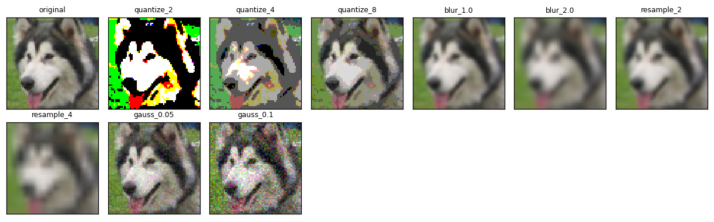

**Frequency patterns (5).** A fine checkerboard (like FTrojan) and smooth low-frequency color noise (like LF). These patterns are weak, so the example image is the flattest of the 400 images.

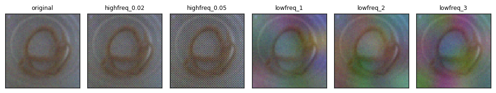

**Geometry (5).** Horizontal flip, vertical flip, rotation by 90°, shift by 8 pixels, zoom of 1.25×.

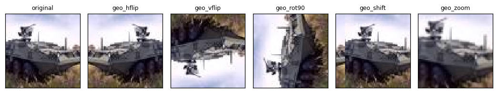

**Replacements (5).** The full image becomes noise, gray, black or white. A clean model puts such an image into some class, and all models do this almost the same. A model with a strong backdoor can put it into the target class.

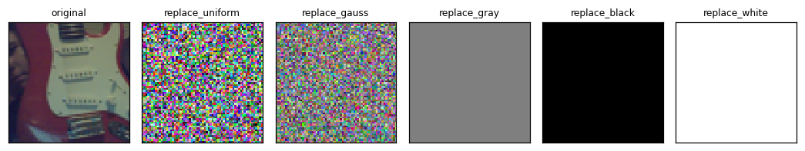

### The scan of one model

The model sees the 400 clean images, and then the 400 images after each probe. For each probe, we make a table of 20 × 20: a row is the true class of the image, a column is the class that the model gives. Each cell is the share of the images that moved (**hit**). A second table keeps the mean change of the log probability (**dlogp**). It also shows a weak pull that does not move the image. One model takes approximately 28 s on a T4 GPU.

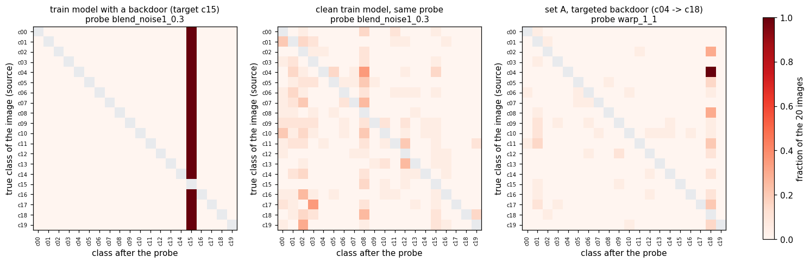

*Left: a train model with a backdoor. Images of all classes go to the target class (red column). Middle: a clean train model with the same probe. Right: a targeted backdoor from our set A. Only one source class goes to the target (one red cell).*

The figure below shows one probe on one train model with a backdoor. A small checkerboard in a corner sends 88% of the images to the class `dugong`. A typical model sends almost no images there.

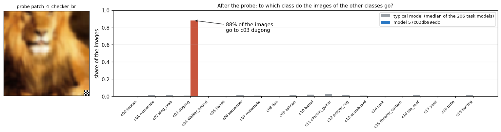

### Comparison with the siblings

Each number is compared with the same number (same probe, same classes) in all other models. The **robust z-score** tells how far this model is from a typical model:

> z = (value − median of all models) / spread

We use the median, because approximately half of the models have a backdoor, and their extreme values would move a mean. Many values are 0 in almost all models, so the spread has a lower limit.

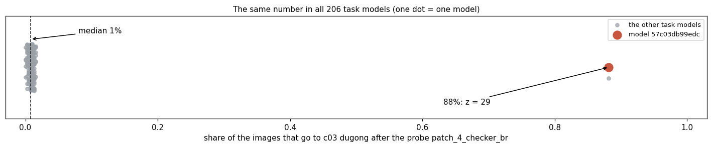

*The same number as above in all 206 task models. Almost all models send approximately 1% of the images to `dugong`. The model with the backdoor sends 88%, so its z is very large.*

### Four parts and one score

For each class, we take the strongest probes and make four parts:

| Part | What it finds |
|---|---|
| `hit_mean_top3` | Images of all classes move to the class (a normal backdoor). |
| `hit_max_top3` | Images of one class move to the class (a targeted backdoor). |
| `dlogp_mean_rel` | All classes are pulled to the class, but do not always move (a weak backdoor). |
| `dlogp_max_rel` | One class is pulled to the class (a weak targeted backdoor). |

The final score `combo4_z` is the mean of the four parts. One part can be large by chance. Four parts together are a pattern.

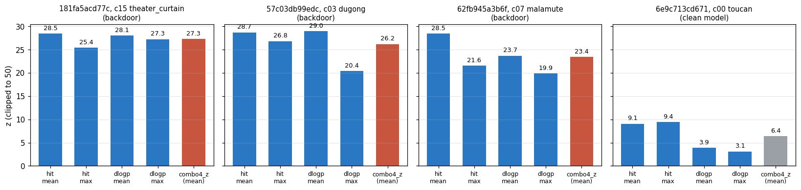

*The four parts and their mean for the 3 backdoor targets of the train models, and for the most suspicious class of a clean train model. In the clean model, this model puts all gray images into `toucan`, and the other models do not. Thus the two hit parts are approximately 9. The two dlogp parts are small, so the mean stays at 6.4. The backdoor targets get 23-27.*

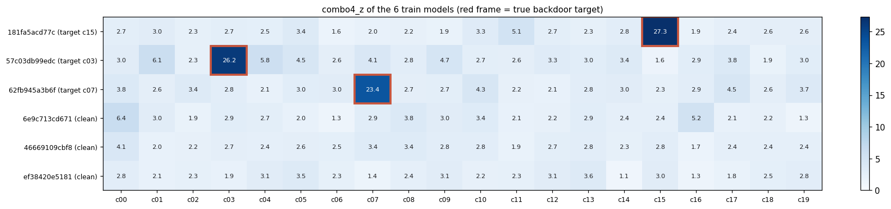

*combo4_z of the 6 train models. The red frame is the true target. The 3 targets get 23-27. All other pairs get 6.4 or less.*

## Validation sets A and B

Three models with a backdoor are too few to compare methods. Thus we made our own models with known backdoors (`src/val_models.py`):

1. Take one of the 3 clean train models.
2. Poison 5-9% of ImageNet 64×64 images of the same 20 classes with 1-3 triggers.
3. Finetune for 4 epochs, as in the task but shorter.
4. Keep the model only if each backdoor has ASR ≥ 0.5. Else try again with stronger triggers (at most 3 attempts).

Set A has the 6 trigger types that we used to design the probe bank. Set B has 7 other types from BackdoorBench. Set B imitates the test triggers "of a different type". The detector saw set B only one time, before the first submission.

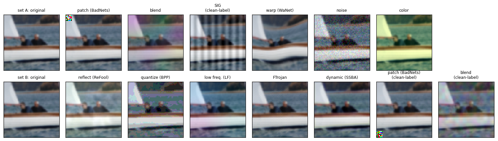

*All trigger types of the two sets on one task image.*

| | Set A | Set B |
|---|---|---|
| Trigger types | patch, blend, SIG, warp, noise, color | reflect, quantize, low frequency, FTrojan, dynamic, clean-label patch, clean-label blend |
| Valid models | 114 of 120 | 69 of 80 |
| Time on 2 × T4 | 2.9 h | 2.4 h |

### How we used them

- **Only to reject a method.** Our models are made differently from the task models, so their score does not predict the leaderboard. Our first detector (trigger inversion) got 0.966 on A and 0.948 on B, but only 0.906 on the leaderboard.
- **40 models of each set.** 20 clean and 20 poisoned models are sufficient to reject a method.
- **Each set separately.** A validation model is compared only with the models of its own set, because these models are siblings.
- **Set A for the decisions.** We compared the parts for each trigger type. Each part has a weak group (blend or targeted). Their mean is never low.
- **Set B for the final check.** The bank has no probe for reflections, BPP, FTrojan or dynamic triggers, but it still finds them.

## Results

| Method | Train | Set A | Set B | Leaderboard (public) |
|---|:---:|:---:|:---:|:---:|
| Neural Cleanse (baseline of the task) | - | - | - | 0.901 |
| **Final: probe bank, `combo4_z`** | **1.00** | **0.991** | **0.9998** | **0.996** |
