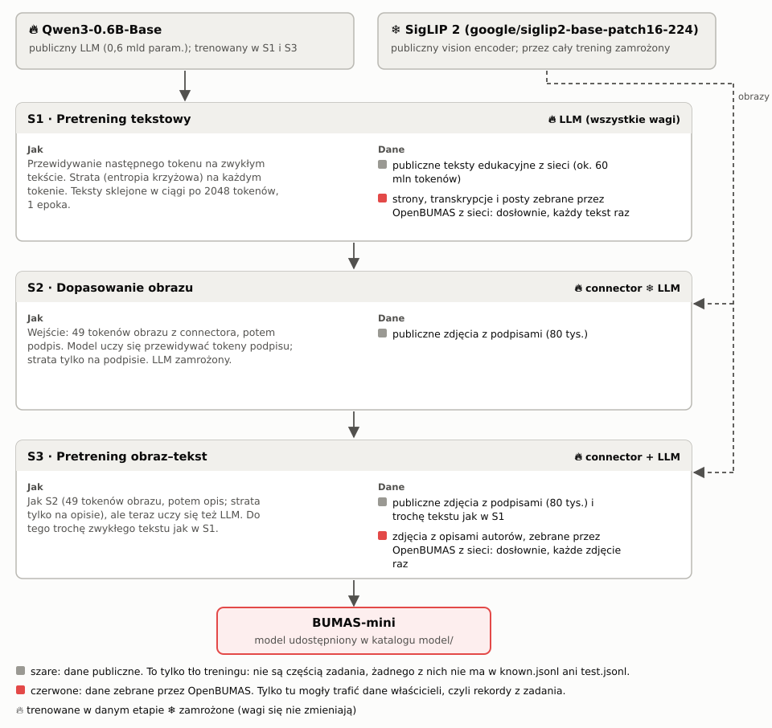
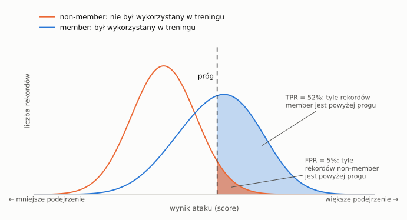

# P3: Did they train on my data?

Audit the training data of a vision-language model that was trained in more than one stage. For each record, tell if the model was trained on it.

- Metric: TPR@5%FPR (a higher value is better)
- Files: .csv, 2.0 MB or less
- Limit: 15 submissions per day for each team
- Deadline: 2026-12-10 16:00

## Task description

**TL;DR:** The company OpenBUMAS trained a small model, BUMAS-mini, that processes text and photos. The start point was the public LLM (large language model) Qwen3-0.6B-Base. OpenBUMAS collected a part of the training data from the web without the permission of the authors. The task: give each record of `test.jsonl` a number. The number tells how much you suspect that the record was used in the training (a larger number = a stronger suspicion). The score is the TPR at 5% FPR (the true positive rate at a false positive rate of 5%). You can mark incorrectly a maximum of 5% of the records that were not used. The score is the fraction of the really used records that you find at this limit.

## Story

You do an audit of training data. Data owners came to you. They suspect that OpenBUMAS used their work:

- ✍️ writers (stories, essays, song lyrics),
- 🔬 research groups (interview transcripts, meeting notes, confidential reviews, paper drafts),
- 🎙️ podcasts (episode transcripts),
- 📷 photographers (photos with their own descriptions).

Persons with single records also came: authors of forum posts and authors of photos on web portals.

## Reminder: how MIA attacks work

An MIA (membership inference attack) tells if a record was used in the training of a model:

- **member**: the record was used in the training,
- **non-member**: the record was not used in the training.

The attack gives each record a number (the score). A larger score means a stronger suspicion that the record was used in the training (member). The attack uses this observation: a model usually "knows" its training data better than data that it did not see.

An LLM gives each token a probability. The loss of a record is the mean "surprise" of the model at its content:

```
loss(x) = −(1/n) · Σ_t log p(x_t | x_1 … x_{t−1})
```

The simplest attack, LOSS (Yeom et al. 2018), supposes that a text from the training gives the model less surprise. It uses the loss directly as the score:

```
score(x) = −loss(x)          # a larger score = a stronger suspicion that x was used in the training
```

This attack has a weak point: some texts are easy and other texts are difficult, also without training. Thus, many papers compare the model with a reference model that surely did not see the data (here: Qwen3-0.6B-Base). Read about the methods that use this (literature, section "Comparison with a reference model").

## How BUMAS-mini was made



BUMAS-mini is a small image-text model with three parts:

- 🔥 **LLM**: Qwen3-0.6B-Base (0.6 billion parameters). OpenBUMAS trained it more in the stages S1 and S3.
- ❄️ **Vision encoder**: SigLIP 2 (`google/siglip2-base-patch16-224`), also public. It changes a 224 × 224 photo into 196 vectors, one for each 16 × 16 pixel patch. No stage trained it.
- 🔥 **Connector**: a small network that OpenBUMAS trained from zero (stages S2 and S3). It joins neighbor vectors in 2 × 2 groups and sends them through an MLP with two layers. The result is 49 "image tokens". The LLM reads them as usual text tokens.

### How the training was done

All stages use the same type of training: next-token prediction (causal language modeling). The model gets a sequence of tokens and predicts the next token at each position. The loss function is the cross-entropy, the mean −log p(correct next token). The AdamW optimizer makes it smaller.

The stages are different in three items:

- the parts of the model that are trained (the other parts are frozen),
- the content of the token sequence (only text, or image tokens with a caption),
- the tokens that the loss uses. The model learns to predict these tokens.

The three stages came one after the other. Each stage started from the result of the stage before it:

- **S1, text pretraining.** Trained: all of the LLM. Sequence: usual text, joined into pieces of 2048 tokens. Loss: on each token. Data: public educational texts from the web, and pages, transcripts and posts that OpenBUMAS collected, used word for word. The model saw each of these texts exactly one time.
- **S2, image alignment.** Trained: only the connector. Sequence: 49 image tokens, then the caption of the photo. Loss: only on the caption tokens. Data: only public photos with captions. The LLM was frozen, thus it kept no data from this stage.
- **S3, image-text pretraining.** Trained: the connector and the LLM. Sequence as in S2: image tokens, then the description, the loss only on the description. Data: public photos with captions, and photos with author descriptions that OpenBUMAS collected. OpenBUMAS used them word for word (the photo with its original description), each exactly one time. A small quantity of usual text was also added, so that the model keeps the results of S1.

The public data (gray in the figure) is not a part of the task. It is the background of the training: no record of `known.jsonl` or `test.jsonl` comes from it. A task record could go into the training only through the data that OpenBUMAS collected (red in the figure).

## Data

Link: [the P3 folder on Google Drive](https://drive.google.com/drive/folders/18bjGNIoUNwg0i1Mkrf0xZTpkioMuMKek?usp=sharing). Download the file `p3_student.zip` (approximately 1.25 GB) and extract it.

- `model/`: BUMAS-mini (`llm/`, `vision/`, `connector.pt`) and `openbumas.py`. This file has the model definition and the functions that change a record into the model input exactly as in the training (`text_example`, `caption_example`).
- `known.jsonl`: 5000 records with a label (details below).
- `test.jsonl`: 5000 records without a label.
- `sources.csv`: the list of the set owners (writers, research groups, podcasts, photographers) with a short description and the number of records in known and test.
- `images/`: the photos of the two files.
- `sample_submission.csv`: an example submission in the correct format (all zeros, thus the score is 0).

**Labels in `known.jsonl`.** The field `member` tells if the record was used in the training (1) or not (0). The owner sets of `sources.csv` have records in known and also in test.

Fields of a record:

| Field | Meaning | Did the model see this field in the training? (member records) |
|---|---|---|
| `id` | identifier for the submission | no |
| `kind` | `text` or `photo` | no |
| `source_type` | writer, research group, podcast, photographer, forum post, web photo | no |
| `source` | the owner: author, group, podcast, photographer. For single records: the forum user name or the portal account name. The sets of writers, groups, podcasts and photographers have the same value in known and test. Each single record has its own value | not as a separate field (but the name can be in the content) |
| `title` | the title of the record | not as a separate field (it is sometimes at the start of the text) |
| `text` | the content of the text | yes: word for word in S1 |
| `image` + `caption` | the photo and its description | yes: word for word in S3 (photo with description) |
| `member` | only in known: 1 = the record was used in the training (member), 0 = it was not (non-member) | no (label) |

## Submission

Send a CSV file with one row for each record of `test.jsonl`, in any order:

```
id,score
3cea8142c8ea,2.71
9b04e6a1c2f0,-0.40
```

The values can be any numbers. Only their order is important: a larger number means a stronger suspicion. The portal rejects the file if an `id` is not in the file, is repeated or not in the test, or if a value is not a finite number. A rejected file also counts for the daily limit.

**Limit:** 15 submissions per day for each team. **Deadline:** 10 December 2026, 16:00.

## Score: TPR at 5% FPR

The submission sets a threshold: records with a score above the threshold are members (used in the training). The threshold is set so that a maximum of 5% of the non-member records are marked incorrectly (FPR, false positive rate). The score is the fraction of the member records that are marked at this threshold (TPR, true positive rate). This is the situation of an auditor: a false accusation is expensive.



In the figure, the orange distribution shows the scores of the non-member records. The blue distribution shows the scores of the member records. The threshold is at the point where 5% of the non-member records are above it. The part of the blue distribution above the threshold is the TPR. If the attack separates the two distributions better, the TPR is higher.

The server calculates the score as this function does:

```python
def tpr_przy_5_fpr(wyniki, etykiety):
    pary = sorted(zip(wyniki, etykiety), key=lambda p: -p[0])
    P = sum(etykiety); N = len(etykiety) - P
    tp = fp = 0; najlepszy = 0.0; i = 0
    while i < len(pary):
        j = i
        while j < len(pary) and pary[j][0] == pary[i][0]:
            j += 1  # rekordy z tym samym wynikiem traktujemy łącznie
        tp += sum(e for _, e in pary[i:j]); fp += sum(1 - e for _, e in pary[i:j])
        if fp / N > 0.05:
            break
        najlepszy = tp / P
        i = j
    return najlepszy
```

Records with the same score go above the threshold all together or not at all. Thus, the same value for all records gives the score 0. Random guesses give approximately 0.05.

## Compute time

One pass of all 10 000 records (known and test) through BUMAS-mini took approximately 6 minutes on one RTX PRO 5000 GPU. Other tasks also used this GPU. The model needs a few GB of GPU memory.

## Hints

- The start point of OpenBUMAS is known: BUMAS-mini came from the public LLM Qwen3-0.6B-Base (`Qwen/Qwen3-0.6B-Base` on Hugging Face).
- An attack that uses only the loss of the model (LOSS) is the simplest MIA attack, and usually the weakest. A good start point is the review of MIA attacks on LLMs (literature, section "Attacks on LLMs").
- The LOSS attack has a weak point: some texts are easy and other texts are difficult, also without training. Thus, many papers compare the model with a reference model that surely did not see the data (here: Qwen3-0.6B-Base). See the literature, section "Comparison with a reference model".
- The records of one owner (the same field `source`) make a set. Do not score only single records. Also score full sets, and aggregate the MIA signals of many records of one owner. Dataset inference uses this idea, see the literature.
- Metadata is important. `source_type` tells the type of the record (a short photo description acts differently from a long transcript). It also tells the stage in which the record could go into the training: texts in S1, photos with descriptions in S3.

## Suggested literature

These papers are not mandatory. In each group, the newest papers are at the top.

### Basics

- Carlini et al., *Membership Inference Attacks From First Principles*, IEEE S&P 2022, arXiv:2112.03570. LiRA, and why the TPR at a low FPR is important, not only the AUC.
- Yeom et al., *Privacy Risk in Machine Learning: Analyzing the Connection to Overfitting*, 2018, arXiv:1709.01604. The LOSS attack.
- Shokri et al., *Membership Inference Attacks against Machine Learning Models*, 2017, arXiv:1610.05820. The first paper about MIA.

### Comparison with a reference model (for example, the base model)

- Fu et al., *Practical Membership Inference Attacks against Fine-tuned Large Language Models via Self-prompt Calibration*, NeurIPS 2024, arXiv:2311.06062. A reference model for models that are fine-tuned from a public base model.
- Mireshghallah et al., *Quantifying Privacy Risks of Masked Language Models Using Membership Inference Attacks*, EMNLP 2022, arXiv:2203.03929. A likelihood ratio test with a reference model.
- Watson et al., *On the Importance of Difficulty Calibration in Membership Inference Attacks*, ICLR 2022, arXiv:2111.08440. Why you must subtract the "difficulty" of a record, which a reference model measures.
- Carlini et al., *Extracting Training Data from Large Language Models*, USENIX Security 2021, arXiv:2012.07805. Comparison with a smaller model and with zlib compression.

### Attacks on LLMs (a good start point)

- Hayes et al., *Exploring the limits of strong membership inference attacks on large language models*, 2025, arXiv:2505.18773. LiRA at a large scale: how much information you can really get from a single record.
- Zhang et al., *Min-K%++: Improved Baseline for Detecting Pre-Training Data from Large Language Models*, ICLR 2025, arXiv:2404.02936.
- Zarifzadeh et al., *Low-Cost High-Power Membership Inference Attacks (RMIA)*, ICML 2024, arXiv:2312.03262.
- Shi et al., *Detecting Pretraining Data from Large Language Models (Min-K%)*, ICLR 2024, arXiv:2310.16789.
- Mattern et al., *Membership Inference Attacks against Language Models via Neighbourhood Comparison*, 2023, arXiv:2305.18462.

### Full sets: dataset inference

- Kowalczuk et al., *Privacy Attacks on Image AutoRegressive Models*, ICML 2025, arXiv:2502.02514. MIA and dataset inference for image autoregressive models (IAR): very few samples are sufficient.
- Dubiński et al., *CDI: Copyrighted Data Identification in Diffusion Models*, CVPR 2025, arXiv:2411.12858. A data owner checks if a diffusion model was trained on the owner's set. The method combines many weak signals.
- Puerto et al., *Scaling Up Membership Inference: When and How Attacks Succeed on Large Language Models*, 2024, arXiv:2411.00154. Single records are difficult, full collections are much easier.
- Maini et al., *LLM Dataset Inference: Did you train on my dataset?*, NeurIPS 2024, arXiv:2406.06443. A statistical test compares the published part and the unpublished part of a set.
- Kandpal et al., *User Inference Attacks on Large Language Models*, 2023, arXiv:2310.09266. Did the model see the data of a specified person?
- Meeus et al., *Did the Neurons Read your Book? Document-level Membership Inference for Large Language Models*, 2023, arXiv:2310.15007.
- Maini, Yaghini, Papernot, *Dataset Inference: Ownership Resolution in Machine Learning*, ICLR 2021, arXiv:2104.10706. The first paper about dataset inference.

### Image-text models

- Lo et al., *COMPASS: Membership Inference Attack Against Vision Large Language Models via Adaptive Noise Calibration*, 2026, arXiv:2610.17332.
- Ren et al., *Self-Comparison for Dataset-Level Membership Inference in Large (Vision-)Language Models*, 2024, arXiv:2410.13088.
- Li et al., *Membership Inference Attacks against Large Vision-Language Models*, NeurIPS 2024, arXiv:2411.02902.

### Correct evaluation of MIA

- Shi T. et al., *OLMo-Detect: A Multi-Stage, Confounder-Controlled Benchmark for Membership Inference on Large Language Models*, 2026, arXiv:2610.02986. MIA at the different stages of training.
- Wang et al., *CheckMIABench: Firm Foundations For Membership Inference Attacks on Language Models*, 2026, arXiv:2606.17464.
- Tong et al., *Pretraining Data Exposure in Large Language Models: A Survey of Membership Inference, Data Contamination, …*, 2026, arXiv:2605.26133. A review.
- Meeus et al., *SoK: Membership Inference Attacks on LLMs are Rushing Nowhere (and How to Fix It)*, 2024, arXiv:2406.17975.
- Das, Zhang, Tramèr, *Blind Baselines Beat Membership Inference Attacks for Foundation Models*, 2024, arXiv:2406.16201.
- Duan et al., *Do Membership Inference Attacks Work on Large Language Models?*, COLM 2024, arXiv:2402.07841.
